# AURA Workflow and Architecture Document

**Purpose:** Visualization and explanation of AURA's user journey, system architecture, and AI decision trees.

---

## 1. User Journey: From Sign-Up to Copilot-Assisted Operations

### High-Level Flow

```mermaid
graph LR
    A["User Sign-Up<br/>(Supabase Auth)"] --> B["Login<br/>JWT Token"]
    B --> C["Dashboard"]
    C --> D{"Action?"}
    D -->|"Build New CRM"| E["CRM Generation Chat"]
    D -->|"Manage Existing CRM"| F["Select CRM from List"]
    E --> G["AI Generates Schema"]
    G --> H["Review & Save Config"]
    H --> I["CRM Saved"]
    F --> I
    I --> J["Records Page"]
    J --> K{"User Action?"}
    K -->|"Create/Update Records"| L["Copilot Tool Calling"]
    K -->|"Query Analytics"| M["Copilot Analytics Query"]
    K -->|"CSV Import"| N["Bulk Upload"]
    L --> O["Copilot: Generate Tool Call"]
    O --> P["Backend: Validate & Execute"]
    P --> Q["Update Records"]
    M --> R["Analytics Query & Visualization"]
    N --> S["Smart Status Mapping"]
    S --> Q
    Q --> T["User Sees Results"]
```

### Detailed: CRM Generation (Steps 1-5)

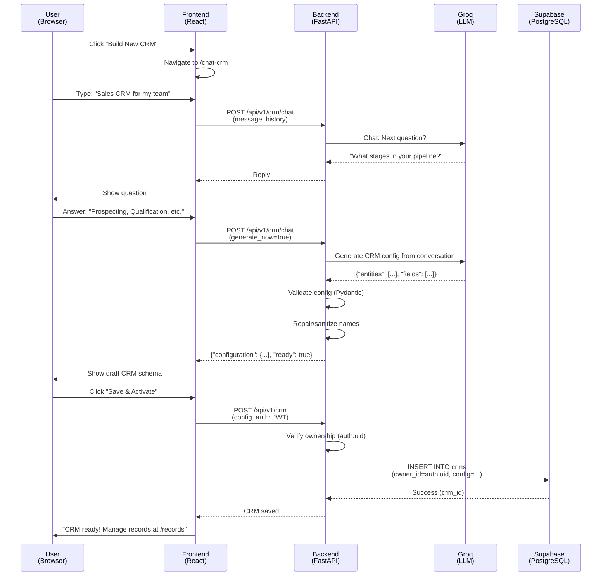

### Detailed: Copilot Record Creation (Steps 6-7a)

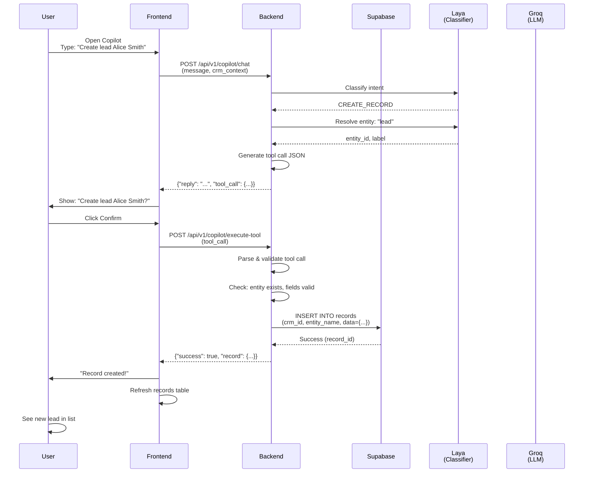

### Detailed: Copilot Analytics Query (Steps 7b)

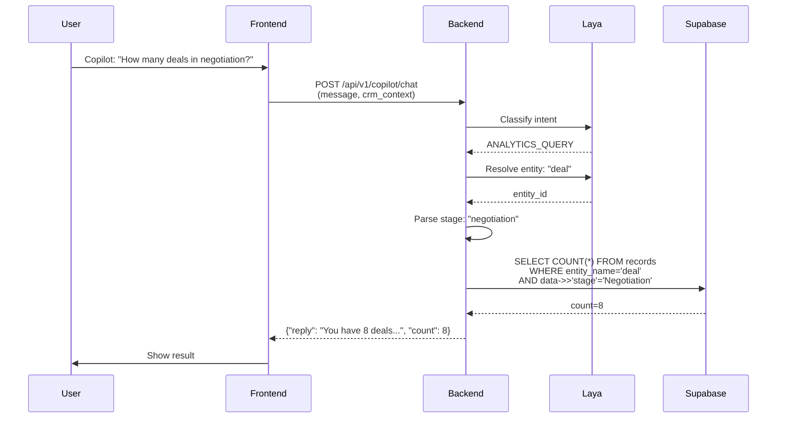

### Detailed: Evolution Proposal Lifecycle (Steps 8)

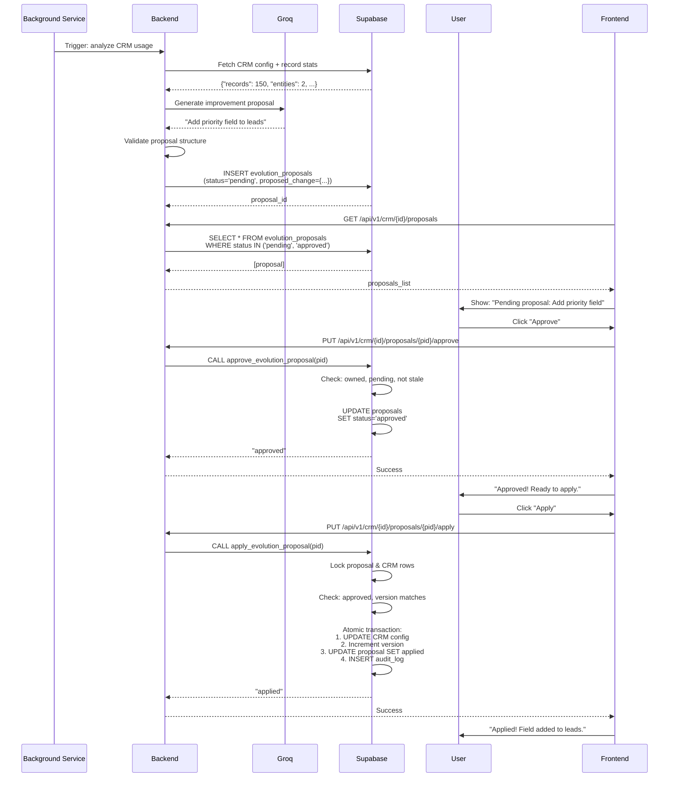

---

## 2. System Architecture

### High-Level Component Diagram

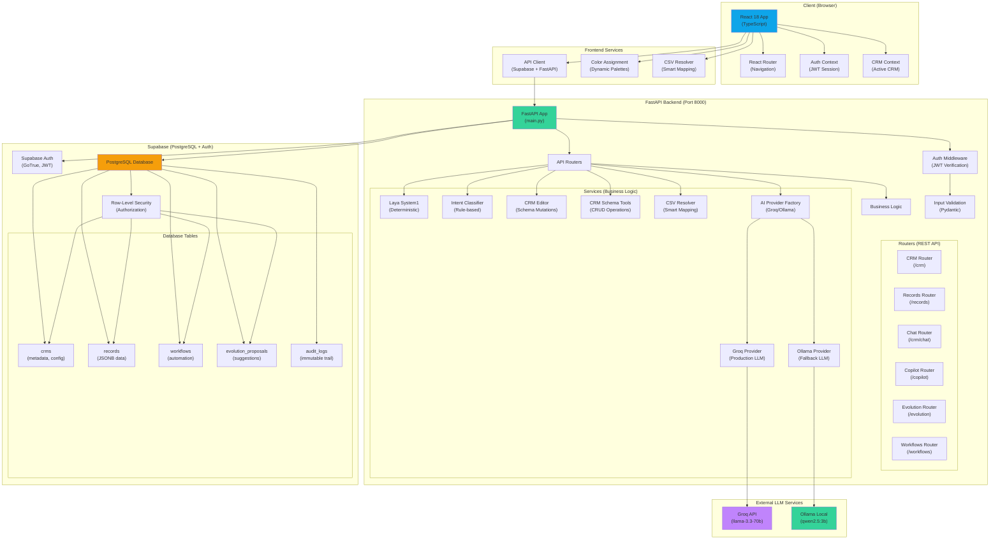

### Data Flow: Request to Database

```mermaid
graph LR
    A["User Request<br/>(React Component)"] 
    --> B["API Client<br/>(Supabase JS or HTTP)"]
    --> C["FastAPI Endpoint<br/>(JWT Verified)"]
    --> D["Authorization Check<br/>(CRM Ownership)"]
    --> E["Business Logic Service<br/>(Laya, Tools, etc.)"]
    --> F["Parameterized Query<br/>(No SQL Injection)"]
    --> G["Supabase Client<br/>(JWT Context)"]
    --> H["PostgreSQL<br/>RLS Policy Applied"]
    --> I["Query Result<br/>(Filtered by auth.uid)"]
    --> J["Response<br/>(Cleaned, No Secrets)"]
    --> K["Frontend State Update<br/>(React)"]
    --> L["User Sees Result<br/>(UI)"]
    
    style A fill:#0ea5e9
    style H fill:#f59e0b
    style K fill:#0ea5e9
```

### Component Responsibilities

| Component | Responsibility | Technology |
|-----------|----------------|-----------|
| **React Frontend** | User interaction, form handling, routing | React 18, TypeScript, Vite |
| **API Client** | HTTP requests to FastAPI, Supabase auth | @supabase/supabase-js, fetch |
| **FastAPI App** | HTTP routing, request/response handling, middleware | FastAPI, Uvicorn |
| **Auth Middleware** | JWT verification, user context extraction | python-jose, Supabase |
| **CRM Editor** | Schema mutations (add/delete/reorder fields/stages) | Python, JSONB manipulation |
| **Tools** | Record CRUD, entity resolution | Python, Supabase client |
| **Laya System1** | Fast, deterministic classification and repair | Python rules engine |
| **Intent Classifier** | Intent detection (ANALYTICS_QUERY, CREATE_RECORD, etc.) | Python heuristics |
| **Groq Provider** | LLM API calls for generation and reasoning | groq Python SDK |
| **Ollama Provider** | Local LLM fallback | ollama Python SDK |
| **Supabase Auth** | User authentication, JWT issuance | GoTrue (Supabase service) |
| **PostgreSQL** | Data persistence, transactions, RLS enforcement | Supabase managed |
| **RLS Policies** | Row-level authorization, multi-tenant isolation | PostgreSQL policies |

---

## 3. AI Copilot Tool-Execution Flowchart

### Two-Phase Copilot Decision Tree

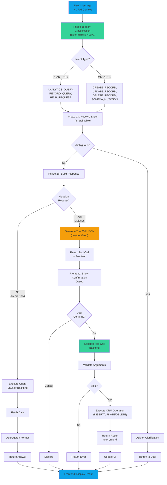

### Tool Allowlist & Execution

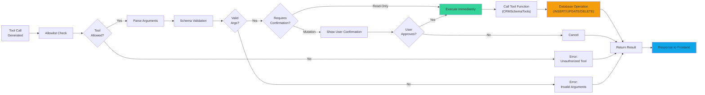

---

## 4. Evolution Proposal: Approval to Application

### Two-Stage Workflow

```mermaid
graph LR
    A["Proposal<br/>Generated"]
    --> B["Status: pending"]
    
    B --> C["User Reviews"]
    C --> D{"Decision?"}
    
    D -->|"Reject"| E["DELETE Proposal<br/>or Mark Rejected"]
    D -->|"Approve"| F["Stage 1:<br/>APPROVE"]
    
    F --> G["RPC:<br/>approve_evolution_proposal"]
    G --> H["Check Authorization<br/>(Owner?)"]
    H --> I{"Owner?"}
    
    I -->|"No"| J["Error:<br/>Not Owner"]
    I -->|"Yes"| K["Check Status<br/>(pending?)"]
    
    K --> L{"Pending?"}
    L -->|"No"| M["Error:<br/>Not Pending"]
    L -->|"Yes"| N["Check Staleness<br/>(version match?)"]
    
    N --> O{"Not Stale?"}
    O -->|"Stale"| P["Mark Stale<br/>Return stale"]
    O -->|"Current"| Q["UPDATE Status<br/>pending → approved"]
    
    Q --> R["INSERT Audit Log<br/>(approval)"]
    R --> S["Return: approved"]
    
    S --> T["Status: approved"]
    
    T --> U["User Reads:<br/>Ready to apply?"]
    U --> V{"Apply?"}
    
    V -->|"No"| W["Leave Approved"]
    V -->|"Yes"| X["Stage 2:<br/>APPLY"]
    
    X --> Y["RPC:<br/>apply_evolution_proposal"]
    Y --> Z["Lock Proposal & CRM Rows"]
    Z --> AA["Check Authorization"]
    AA --> AB["Check Status<br/>(approved?)"]
    AB --> AC["Check Staleness"]
    
    AC --> AD{"All Checks<br/>Pass?"}
    AD -->|"No"| AE["Rollback<br/>Return Error"]
    AD -->|"Yes"| AF["Execute Allowlisted Change<br/>(Atomic)"]
    
    AF --> AG["1. UPDATE CRM Config"]
    AG --> AH["2. Increment Version"]
    AH --> AI["3. UPDATE Proposal<br/>approved → applied"]
    AI --> AJ["4. INSERT Audit Log<br/>(application)"]
    AJ --> AK["COMMIT Transaction"]
    
    AK --> AL["Status: applied"]
    
    E --> AM["End: Rejected"]
    J --> AM
    M --> AM
    P --> AM
    AE --> AM
    W --> AM
    AL --> AN["End: Applied"]
    
    style F fill:#fbbf24
    style X fill:#f59e0b
    style AF fill:#34d399
    style AN fill:#10b981
    style AM fill:#ef4444
```

---

## 5. Database Schema Relationships

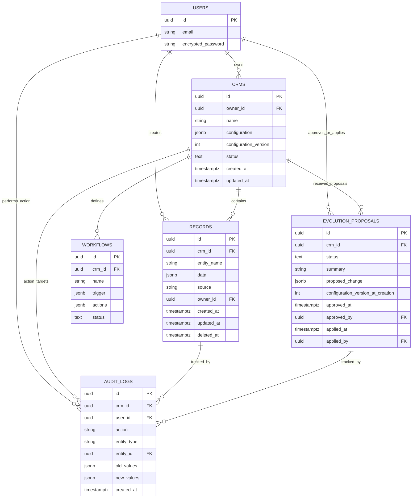

---

## 6. Security Architecture

### Authentication & Authorization Flow

```mermaid
graph TD
    A["User Visits<br/>Frontend"]
    --> B["Supabase Auth Check"]
    B --> C{"JWT Token<br/>Valid?"}
    
    C -->|"No"| D["Redirect to Login"]
    D --> E["User Logs In"]
    E --> F["Supabase GoTrue<br/>Issues JWT"]
    
    C -->|"Yes"| G["Frontend Stores JWT"]
    F --> G
    
    G --> H["User Navigates"]
    H --> I["Include JWT in API Request<br/>Authorization: Bearer ..."]
    
    I --> J["FastAPI Receives Request"]
    J --> K["CurrentUser Dependency"]
    K --> L["Extract sub from JWT"]
    L --> M["Call Supabase API<br/>with JWT Context"]
    
    M --> N["Supabase Auth Verifies JWT"]
    N --> O["Sets auth.uid() = sub"]
    
    O --> P["Business Logic Executes<br/>(e.g., fetch CRMs)"]
    P --> Q["Database Query<br/>SELECT * FROM crms"]
    
    Q --> R["RLS Policy Applied"]
    R --> S["WHERE owner_id = auth.uid()"]
    S --> T["Only User's CRMs<br/>Returned"]
    
    T --> U["Response Sanitized<br/>(No Secrets)"]
    U --> V["Response Sent to Frontend"]
    V --> W["User Sees Data<br/>(Their CRMs Only)"]
    
    style G fill:#10b981
    style O fill:#10b981
    style S fill:#10b981
    style W fill:#0ea5e9
```

### RLS (Row-Level Security) Enforcement

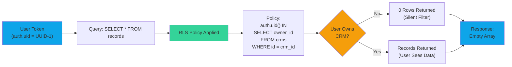

---

## 7. LLM Integration: System 1 vs. System 2

### Decision Tree: When to Use Each System

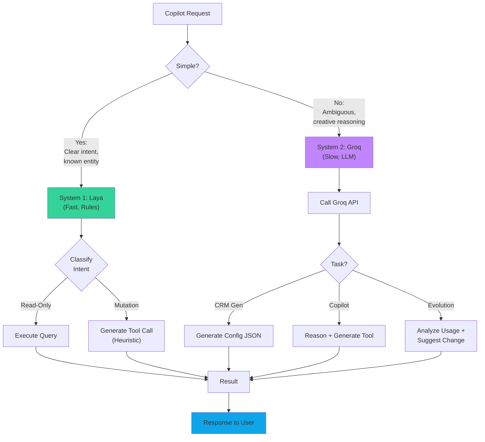

### Fallback Strategy

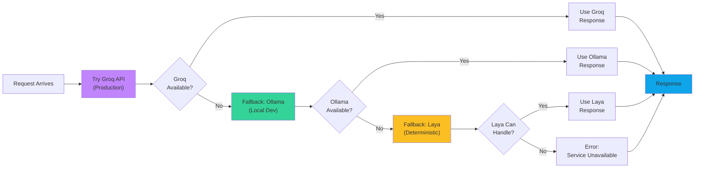

---

## 8. Scaling Considerations

### Multi-Tenant Architecture

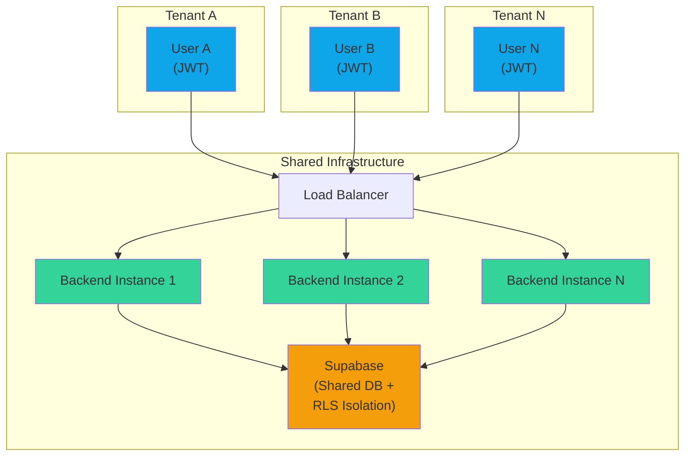

**Key Points:**
- RLS enforces isolation at database level (no app-layer complexity)
- Horizontal scaling: Add more backend instances behind load balancer
- Supabase handles connection pooling and query scaling
- All tenant data in single tables; RLS filters transparently

---

**End of Workflow and Architecture Document**
